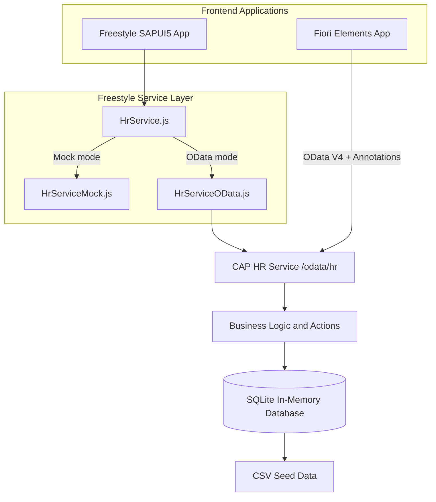

# Employee Central – HR Self-Service Portal

An HR self-service portal built using **SAP CAP, SAPUI5, OData V4, and SAP Fiori Elements**.

The application enables employees to submit leave requests, view attendance records, and access payslips. Managers can review, approve, or reject leave requests.

The project demonstrates how a single SAP CAP backend can serve two frontend applications built using different SAP Fiori development approaches.

---

## 1. Applications

| Application | Technology | Features |
|---|---|---|
| `app/employee-central` | SAPUI5 Freestyle | Home, My Leave, Leave Request Dialog, Attendance, Payslips, Manager Approvals |
| `app/leaverequests` | SAP Fiori Elements | Leave Requests List Report, Object Page, Approve/Reject actions |

### Application Highlights

**Freestyle SAPUI5 Application**
- Employee dashboard.
- Leave request submission.
- Leave balance and request history.
- Attendance records.
- Payslip access.
- Manager approval workflow.

**Fiori Elements Application**
- Annotation-driven List Report.
- Object Page for leave request details.
- Bound Approve and Reject actions.
- Status criticality indicators.

---

## 2. Architecture

The application follows a layered architecture with two frontend applications sharing one CAP backend.



### Architecture Components

| Component | Responsibility |
|---|---|
| Freestyle SAPUI5 | Custom employee and manager workflows |
| Fiori Elements | Annotation-driven standard SAP Fiori application |
| `HrService.js` | Selects mock or OData implementation |
| `HrServiceMock.js` | Provides local mock data |
| `HrServiceOData.js` | Communicates with the CAP OData backend |
| SAP CAP | Implements services, actions, functions, and business validations |
| SQLite | Stores application data during local development |
| CSV files | Provide initial database records |

Both frontend applications use the same CAP service when operating in OData mode.

---

## 3. Technology Stack

| Technology | Purpose |
|---|---|
| SAPUI5 | Freestyle frontend development |
| SAP Fiori Elements | Annotation-driven frontend development |
| SAP CAP (CDS) | Backend application development |
| Node.js | Backend runtime |
| OData V4 | Frontend-backend communication |
| SQLite | Local development database |
| CSV | Initial seed data |
| QUnit | Unit testing |
| OPA5 | UI integration testing |

---

## 4. Project Structure

```text
employee-central-srv/
│
├── app/
│   ├── employee-central/
│   │   └── webapp/
│   │       ├── controller/
│   │       ├── view/
│   │       ├── model/
│   │       ├── service/
│   │       │   ├── HrService.js
│   │       │   ├── HrServiceMock.js
│   │       │   └── HrServiceOData.js
│   │       ├── test/
│   │       │   ├── unit/
│   │       │   └── integration/
│   │       ├── manifest.json
│   │       └── index.html
│   │
│   └── leaverequests/
│       ├── webapp/
│       └── annotations.cds
│
├── db/
│   ├── schema.cds
│   └── data/
│       ├── hr-Employees.csv
│       ├── hr-LeaveTypes.csv
│       ├── hr-LeaveBalances.csv
│       ├── hr-LeaveRequests.csv
│       └── hr-Payslips.csv
│
├── srv/
│   ├── hr-service.cds
│   └── hr-service.js
│
├── package.json
├── package-lock.json
└── README.md
```

The structure shows the main application files. Additional generated configuration and deployment files may also exist.

---

## 5. Prerequisites

- Node.js
- npm
- SAP CAP CDS development tools
- Visual Studio Code or another compatible editor
- Basic knowledge of JavaScript, CDS, and SAPUI5

---

## 6. Installation and Execution

### Step 1: Open the project

Open the `employee-central-srv` folder in Visual Studio Code or SAP Business Application Studio.

### Step 2: Install dependencies

```bash
npm install
```

### Step 3: Start the CAP server

```bash
npx cds watch
```

### Step 4: Open the application

Navigate to:

```text
http://localhost:4004
```

The CAP welcome page provides access to the available applications and service endpoints.

### Step 5: Select the data mode

The freestyle application supports two data modes.

**Mock mode**

Uses the local mock service by default.

**OData mode**

Uses the CAP backend through the OData adapter.

Example:

```text
http://localhost:4004/employee-central/webapp/index.html?data=odata
```

Use the actual application route displayed on your CAP welcome page if it differs.

### Database behavior

The project currently uses SQLite in-memory storage.

- Initial records are loaded from CSV files in `db/data`.
- Changes are stored during the current server session.
- Data resets to the CSV seed records whenever the server restarts.

---

## 7. Development Users

The following credentials are intended for local development and demonstration.

| Username | Password | Role | Employee ID |
|---|---|---|---|
| siri | siri | Employee | E001 |
| anil | anil | Employee | E003 |
| ravi | ravi | Manager | E002 |

**Security note:** These are development credentials with mocked authentication. They must not be used in production.

The manager role is required for the Fiori Elements Approve and Reject actions, subject to the configured authentication and authorization setup.

A production application should integrate an appropriate identity provider, such as SAP Cloud Identity Services (IAS), with properly configured identity attributes and role assignments.

---

## 8. Backend – SAP CAP

The backend exposes the HR service at:

```text
/odata/hr
```

### Entities

- Employees
- LeaveTypes
- LeaveBalances
- LeaveRequests
- Payslips

### Actions

| Action | Description |
|---|---|
| `submitLeaveRequest` | Submits an employee leave request |
| `approve` | Approves a leave request |
| `reject` | Rejects a leave request |
| `decideLeaveRequest` | Legacy decision action present in the previously shared backend implementation |

The `approve` and `reject` operations are bound to the LeaveRequests entity.

**Note:** The legacy `decideLeaveRequest` action accepts a manager ID from the client in the previously shared implementation. It should be removed or secured before production use. The preferred design is to use the authenticated user's identity for manager decisions.

### Function

| Function | Description |
|---|---|
| `getAttendance` | Retrieves attendance records for an employee |

### Business Validations

The previously shared CAP backend implements validations for:

- Required leave request fields.
- Valid start and end dates.
- Prevention of past-date requests.
- Working-day calculations.
- Available leave balance.
- Overlapping leave requests.
- Manager-to-employee relationship checks in the decision handler.
- Prevention of repeated approval or rejection.
- Mandatory comments when rejecting a request.

### Authorization and Security Considerations

The following items require server-side verification and hardening before production:

- Employee identity should be derived from the authenticated user context, not trusted from client-supplied IDs.
- Manager identity should be derived from the authenticated user context.
- Employees should only access their own sensitive records.
- Managers should only access records belonging to their authorized teams.
- Attendance and payslip access must be authorized on the backend.
- Entity read restrictions must be implemented and tested.
- Approval and balance updates should be handled safely under concurrent requests.

**Important:** Client-side filters are not a substitute for backend authorization. The current development implementation should not be described as production-ready role-based data security until these protections have been verified.

---

## 9. Testing

### Freestyle Application Tests

The freestyle application includes:

**QUnit**
- Unit testing of application logic and individual functions.

**OPA5**
- Integration testing of UI workflows and user interactions.

Test directory:

```text
app/employee-central/webapp/test/
```

Unit test URL:

```text
/test/unit/unitTests.qunit.html
```

Integration test URL:

```text
/test/integration/opaTests.qunit.html
```

Open the test pages using the same host as the application.

### Recommended Backend Tests

Additional CAP tests should cover:

- Valid leave request submission.
- Insufficient leave balance.
- Overlapping leave requests.
- Invalid date ranges.
- Unauthorized approval attempts.
- Approval by an unrelated manager.
- Repeated approval attempts.
- Rejection without a comment.
- Unauthorized attendance and payslip access.

---

## 10. Key Design Decisions

| Decision | Reason |
|---|---|
| Mock and OData service adapters | Allows switching data sources without rewriting UI controllers |
| One shared CAP backend | Maintains consistent business logic across both applications |
| Server-side business validations | Helps prevent users from bypassing validation through direct API calls |
| Bound approval actions | Supports manager authorization based on authenticated identity when correctly configured |
| Freestyle SAPUI5 | Supports custom workflows and application-specific interactions |
| Fiori Elements | Uses annotations to generate standard SAP Fiori interfaces |
| Controller-managed loading and error states | Improves UI consistency and error handling |
| CSV seed data | Simplifies local development and repeatable demonstrations |

---

## 11. Known Limitations and Future Enhancements

### Current Limitations

1. **Mocked authentication:** Development login is not suitable for production.
2. **In-memory database:** Data resets when the CAP server restarts.
3. **OData integration:** The freestyle adapter currently uses HTTP requests through `fetch()` rather than binding every UI component directly to `sap.ui.model.odata.v4.ODataModel`.
4. **Payslip implementation:** Production document storage and secure PDF delivery require further integration.
5. **Backend security:** Entity reads and custom operations require verified server-side authorization.
6. **Legacy decision action:** The previously shared implementation includes a client-supplied manager ID in `decideLeaveRequest`; this requires removal or security correction.
7. **Concurrent approvals:** Transaction-safe balance updates require further verification.

### Future Enhancements

- Integrate SAP Cloud Identity Services (IAS).
- Introduce a persistent database.
- Implement comprehensive entity-level authorization.
- Use SAPUI5 OData V4 model bindings where appropriate.
- Use `Core.OperationAvailable` to disable actions for already-decided requests.
- Improve transactional handling of concurrent leave approvals.
- Add automated CAP backend tests.
- Implement production-ready payslip PDF delivery.
- Deploy the application to SAP BTP.

---

## 12. Screenshots

Add the following screenshots to your project if they are available.

### Employee Home


### Manager approvals


### Fiori Elements – Leave Requests


---

## 13. Learning Outcomes

This project demonstrates practical work with:

- SAP CAP backend development.
- CDS data modeling and service definitions.
- SAPUI5 MVC architecture.
- XML Views and JavaScript Controllers.
- SAP Fiori freestyle application development.
- SAP Fiori Elements List Report and Object Page.
- OData V4 integration.
- Bound actions and functions.
- CDS annotations.
- Server-side business validations.
- Authorization design considerations.
- QUnit and OPA5 testing.
- Frontend and backend integration.

---

## 14. SAP Fiori Application Generator Details

The `employee-central` freestyle frontend was initially generated using SAP Fiori Tools.

| Detail | Value |
|---|---|
| Generator | SAP Fiori Application Generator 1.34.0 |
| Development Environment | SAP Business Application Studio |
| Template | Basic |
| Module Name | employee-central |
| Application Namespace | `com.ec.hrportal` |
| Initial Application Title | App Title |
| UI5 Theme | `sap_horizon` |
| UI5 Version | 1.153.0 |
| TypeScript | No |
| ESLint | Yes |

These details describe the generated freestyle frontend scaffold, not the entire CAP project. The frontend was subsequently integrated with the CAP backend.

---

## 15. Project Objective

The objective of Employee Central is to demonstrate how a real-world HR self-service application can be developed using SAP technologies.

By combining SAPUI5 Freestyle and SAP Fiori Elements with a shared SAP CAP backend, the project demonstrates the ability to choose appropriate frontend development techniques while maintaining centralized business logic, data consistency, and a clear authorization design.

**Project:** Employee Central – HR Self-Service Portal

**Technology:** SAP CAP | SAPUI5 | SAP Fiori Elements | OData V4 | SQLite

**Development Approach:** Mock Data First, Followed by Backend Integration